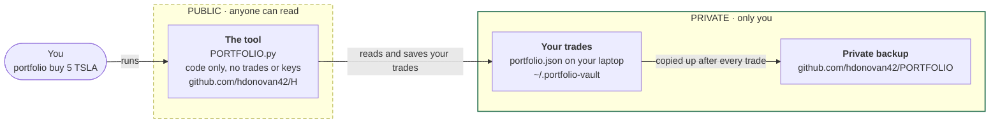

# PORTFOLIO

A single-file command-line stock portfolio tracker. Records buy/sell transactions,
derives your current holdings, and shows live valuations with `rich`-formatted tables.

Your trade data is **not** stored in this repo. It lives in a separate private git
repo cloned to `~/.portfolio-vault/`, and every mutation is auto-committed and pushed —
so your ledger stays in sync (and backed up) across every machine you use.

## How it works



Prices come from Yahoo and Finnhub, asked for by ticker name only (e.g. `TSLA`).
How many shares you hold is never sent anywhere except your private backup.

- **Transactions are the source of truth.** Each `buy`/`sell` appends an immutable
  record (action, ticker, quantity, price) to `portfolio.json`. Current positions
  are *recomputed* from the full transaction list on every read — never stored as
  authoritative state.
- **The data vault is a separate private repo.** `PORTFOLIO.py` reads and writes
  `~/.portfolio-vault/portfolio.json`; the directory is a clone of
  `github.com/hdonovan42/PORTFOLIO`. After each change the CLI runs
  `git add` → `commit` → `push` automatically (failures are warned about, not fatal —
  the local write is always kept).
- **Writes are atomic.** State is written to a `.json.tmp` file and then
  `os.replace`d into place, so an interrupted run can't corrupt your ledger.
- **Live prices** come from a Cloudflare Worker proxy
  (`dry-poetry-72b5.donovanh59.workers.dev`): Finnhub first, Yahoo as fallback.
  Tickers whose price can't be fetched are shown as `—` and excluded from the
  total and the weights.

## Setup (first run on a new machine)

The CLI refuses to run until the data vault exists locally. Bootstrapping is two steps:

1. **Confirm git/`gh` auth** on this machine can read the private
   `hdonovan42/PORTFOLIO` repo.

2. **Clone the data vault** — this is what `setup-vault.sh` does:

   ```bash
   bash projects/portfolio/setup-vault.sh
   ```

   The script:
   - Clones the private repo into `~/.portfolio-vault/`
     (override the URL with `PORTFOLIO_REPO_URL` if needed).
   - If the repo has no `portfolio.json` yet, seeds an empty one
     (`{"version": 1, "transactions": [], "positions": {}}`) and commits + pushes it.
   - Is **idempotent** — if `~/.portfolio-vault/` already exists it just reports
     "✓ Vault already present" and exits cleanly, so it's safe to re-run.

3. **Install dependencies:**

   ```bash
   pip install -r projects/portfolio/requirements.txt
   ```

   On PEP 668 systems (Debian/Ubuntu 23.04+) add `--user --break-system-packages`,
   or use a virtualenv.

4. **(Optional) Add a global alias** so you can run it from anywhere:

   ```bash
   echo 'alias portfolio="python3 '"$PWD"'/projects/portfolio/PORTFOLIO.py"' >> ~/.bashrc
   source ~/.bashrc
   ```

## Usage

```bash
portfolio buy 10 AAPL @ 401.00   # buy 10 AAPL at $401.00
portfolio sell 4 AAPL @ 415.50   # sell 4 (refuses if you hold fewer than 4)
portfolio buy 10 AAPL            # no price → asks: current price or enter your own
portfolio value                  # holdings with live prices, weights + total (heaviest first)
portfolio history                # full transaction ledger (with recorded prices)
portfolio sp500 2021-11          # what the S&P 500 returned from a date → today
portfolio                        # no subcommand → interactive prompt
```

Every `buy`/`sell` records a **price**. Supply it with `@` (e.g. `buy 10 AAPL @ 401.00`).
Leave it off and the CLI follows up with a choice — use the current market price
(shown as a preview) or type your own:

```
portfolio buy 10 AAPL
→ No price given. [1] at current price ($401.23)  [2] enter price
```

Tickers are upper-cased automatically. Quantities must be integers ≥ 1 and prices
must be > 0. `buy` and `sell` print a before/after positions table and the committed
message. Run `portfolio --help` for the full command reference.

## S&P 500 comparison (`sp500`)

**The question it answers:** if I had put my money in an S&P 500 index fund on
one date instead, what would it be worth on another? That is the bar any stock
pick has to clear — if it didn't beat this, a tracker fund would have done better.

```bash
portfolio sp500 2021-11                    # from November 2021 → today
portfolio sp500 2000 2010                  # between two dates
portfolio sp500 2015 --amount 10000        # growth of $10,000 instead of $1
portfolio sp500 2015 --vs AAPL             # AAPL against the S&P 500, same dates
portfolio sp500 2021-11 --vs 30%           # a return you made against the S&P 500
```

```
   S&P 500 total return  2021-11-01 → 2026-10-21  (5.0y)
┌───────────────────────────────┬──────────────────────────┐
│ Growth of $1                  │                  $1.8042 │
│ Total return                  │                   +80.4% │
│ Annualised                    │               +12.61%/yr │
└───────────────────────────────┴──────────────────────────┘
```

### Reading the output

| Row | Meaning |
|-----|---------|
| **Growth of $1** | What $1 (or `--amount`) at the start was worth at the end. |
| **Total return** | The gain over the whole period: +80.4% means $1 → $1.80. |
| **Annualised** | The steady yearly rate that compounds to the same total — the fair way to compare periods of different lengths. |
| **Ahead of / Behind the S&P 500** | With `--vs`: the gap between its annualised return and the S&P 500's, in percentage points a year. |

The title shows the dates actually used — see *Dates* below.

### What is measured

- **The S&P 500 Total Return index** (`^SP500TR`), which assumes every dividend
  is reinvested. That is what an index fund holder actually gets. The plain
  S&P 500 figure quoted in the news leaves dividends out and understates the
  return by roughly 1.5–2 points a year: from November 2021 it shows +68%
  against the true +80%.
- **Not included:** fund fees (0.03–0.10% a year for a typical tracker), tax,
  and the dollar/pound exchange rate. Everything is in US dollars.
- **`--vs TICKER`** uses that stock's adjusted closes, which also count its
  dividends and splits, so the two are compared on the same terms.
- **`--vs 30%`** takes a total return you made yourself over the same period.

### Dates

- Write a date as `2021`, `2021-11` or `2021-11-15`. A year means 1 January
  and a month means the 1st.
- Markets close at weekends and on holidays, so each date uses the closing level
  on the nearest trading day. `2010` therefore starts at the 31 December 2009
  close, the usual convention for calendar-year returns.
- Leave END off for today. While the US market is open, that uses the latest
  price.
- History starts on **4 January 1988**.

### Where the numbers come from

Yahoo Finance, through the same Cloudflare Worker that supplies live prices.
No API key is needed.

- **Index history:** the first run downloads the full daily history in one
  call (about 9,800 days, 250 KB) and saves it in
  `~/.cache/portfolio/sp500tr.json`. A day's close never changes once the day
  is over, so later runs only fetch days added since the last run. A window
  that ends in the past needs no download at all. A window that ends today
  makes one small call for the latest price.
- **Stock prices:** each `--vs TICKER` run fetches two prices fresh, one for
  each date. They aren't saved because Yahoo rescales a stock's whole
  adjusted-price history after every dividend, so stored prices would stop
  lining up with new ones.
- **Offline:** if the download fails, the command uses the saved history and
  says how far it reaches.

**Checked against S&P's published figures.** Calendar-year total returns match
to the decimal: 2020 +18.4%, 2021 +28.7%, 2022 −18.1%, 2023 +26.3% and
2024 +25.0%. The 2010–2019 annualised return matches too, at +13.56% a year.

## Files

| File | Purpose |
|------|---------|
| `PORTFOLIO.py` | The CLI (click commands + rich rendering). |
| `setup-vault.sh` | One-time per-machine bootstrap — clones the private data vault. |
| `requirements.txt` | `click`, `rich`, `requests`. |

## Data layout

`~/.portfolio-vault/portfolio.json`:

```json
{
  "version": 1,
  "transactions": [
    { "id": 1, "ts": "2026-06-02T09:30:00Z", "action": "BUY", "ticker": "AAPL", "quantity": 10, "price": 401.00 }
  ],
  "positions": {}
}
```

`positions` on disk is incidental — it's always recomputed from `transactions` at load time.
